<p align="center">
  <picture>
    <source media="(prefers-color-scheme: dark)" srcset="./assets/banner-dark.svg">
    <source media="(prefers-color-scheme: light)" srcset="./assets/banner-light.svg">
    
  </picture>
</p>

> 我常做的事：把一个每天要点五次按钮的流程，拆成一次抓包、一段签名、一个 cron，然后忘掉它。

## 运行中

| 项目 | 说明 | 关键技术 | 状态 |
|:---|:---|:---|:---|
| **[smzdm-checkin](https://github.com/ilostindream/smzdm-checkin)** | 什么值得买每日自动签到：云端定时运行，无需开机，结果推送微信 | Android 客户端协议模拟 · MD5 参数签名 | 🟢 `public` |
| 车机 App 签到（未开源） | 某新能源车企 App 每日签到与积分任务，长期无人值守 | AES/RSA 双向加密网关还原 · 模拟器证书注入 | 🔒 `private` |
| 每日情报简报（未开源） | 多源信息定时抓取、增量去重合并、摘要后推送 | 调度编排 · 增量去重 · LLM 摘要 | 🔒 `private` |
| 配额守护（未开源） | AI 助手积分签到与令牌自动轮换，失效自愈 | 令牌轮换协议 · 云端任务托管 | 🔒 `private` |

## 工具链

| 领域 | 常用 |
|:---|:---|
| 语言 | Python —— 优先裸 `requests` / `urllib`，能不引依赖就不引 |
| 调度 | GitHub Actions cron · 云端定时任务 |
| 逆向 | Reqable / mitmproxy 抓包 · MuMu 模拟器 + 用户证书注入 · dex 静态分析 |
| 加密 | AES-ECB / CBC · RSA · MD5 参数签名 |
| 交付 | PushPlus 推送 → 微信 |

## 一条典型链路

```text
cron 触发（云端，本机不开机也照跑）
 └─ 读取 Secrets 凭证
     └─ 计算签名 / 构造密文
         └─ 调用目标接口（幂等，可安全重试）
             └─ 结果格式化 → PushPlus → 微信
```

## 原则

- 只自动化**自己的**账号，不碰别人的数据
- 幂等优先：重复执行不产生副作用
- 能走协议就不做 UI 自动化，能无依赖就不引依赖
- 失效要能自愈，至少要能喊人

---

<p align="center"><sub>lostindream · since 2015</sub></p>
